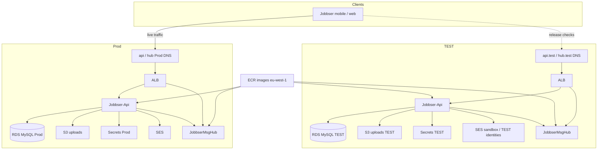

# Architecture: Prod vs TEST

Design target for Task 3. Shapes match the AWS inventory pack. No account IDs or
real ARNs.

## Picture

No arrow from TEST compute to Prod RDS. That is intentional.

## Service parity table

| Concern | Prod | TEST | Same shape? | Notes |
| --- | --- | --- | --- | --- |
| Region | eu-west-1 | eu-west-1 | yes | Inventory default |
| ECS cluster | Prod cluster | Own TEST cluster | yes | Separate cluster name / account preferred |
| Jobbser-Api | Fargate service | Fargate service | yes | Lower desired count OK |
| JobbserMsgHub | Fargate service | Fargate service | yes | Include for realtime parity |
| Task size | ~0.25 vCPU / 0.5 GB class | Same class as starting point | yes | Inventory examples |
| ALB | Public HTTPS | Own ALB | yes | Own listeners / target groups |
| VPC | Prod VPC | Own VPC / isolated CIDR | yes | No path to Prod DB |
| NAT / egress | As used in Prod | Prefer single NAT | mostly | Cost knob; still private tasks |
| RDS MySQL | Prod instance | **Own** instance | yes | Never share endpoint |
| RDS sizing | Small class historically | Single-AZ, ≤ Prod class | similar | Failover testing is a special run |
| S3 | Prod uploads | Own TEST bucket | yes | Separate IAM |
| SES | Prod sending | Sandbox or TEST domain | yes | Block real customer mail |
| Secrets Manager | Prod runtime secret(s) | Own TEST secret(s) | yes | One secret (or small set) per env |
| DNS | Prod API + hub names | `api.test` / `hub.test` style | yes | Exact zone: kickoff |
| ECR | eu-west-1 images | Same registry, TEST deploys | yes | Digests pinned per release |
| CloudWatch logs | Per-service groups | Own log groups, shorter retention | yes | Noise vs cost |
| IAM task roles | Prod roles | TEST roles only | yes | Least privilege |
| Deploy path | CI → ECS update | Same CI, TEST environment | yes | Approval on Prod still stricter |
| Stripe / Firebase | Live / prod projects | Test projects only | yes | Outside AWS but part of parity |

## Account boundary (assumption)

Inventory does not say whether Dev/Prod share an account. My preference for TEST:

1. **Best:** dedicated AWS account under the org, with a copy role that can only pull
   approved RDS snapshots into TEST for refresh.
2. **Acceptable short-term:** same account, separate VPC, hard SG deny between TEST
   and Prod data plane, separate secrets and KMS where used.

I would not call same-account “done” isolation without the probes in
`testing-approach.md`.

## Naming sketch

Illustrative only (matches inventory-style names like `jobbser-prd-api`):

| Thing | Example |
| --- | --- |
| API task family | `jobbser-test-api` |
| MsgHub task family | `jobbsermsghub-test` |
| Cluster | `jb-test` |
| RDS id | `jb-test-mysql` |
| Secret | `jobbser/test/api-runtime` |
| Bucket | `jb-test-uploads-<suffix>` |
| Tags | `jb_project=jobbser`, `jb_env=test`, `jb_component=…` |

## What I deliberately do not clone 1:1

- Prod Multi-AZ / higher task counts (unless the release specifically needs them)
- Prod Stripe live keys, Prod JWT signing key, Prod Firebase project
- Prod S3 contents (refresh may copy a small anonymised asset set or use placeholders)
- Always-on Dev sitting next to always-on TEST

Same shape. Smaller blast radius. Smaller bill where honest.
